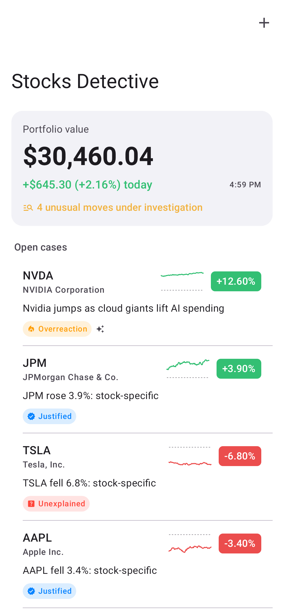
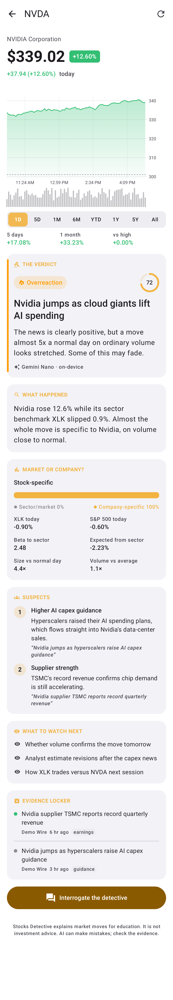
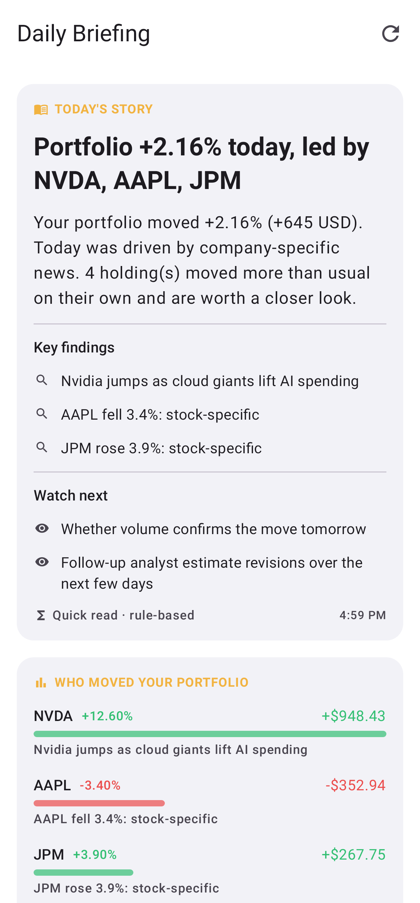
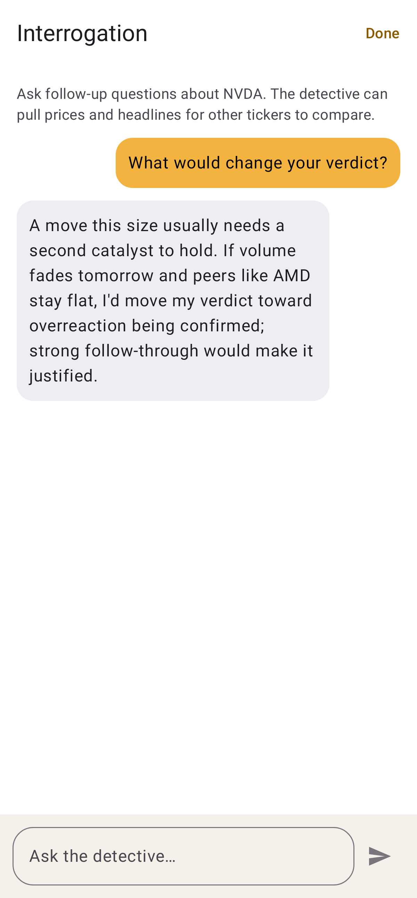

# Stocks Detective for Android

**An AI-powered portfolio analyst for Android, with on-device Gemini Nano.**
This is the Android port of the iPhone app ([stasgold/stocks-detective](https://github.com/stasgold/stocks-detective)).

Most apps tell you *"AAPL is down 3%."* Stocks Detective tells you **why**:

1. **What happened**: the move in plain English, with the numbers that matter.
2. **Which news caused it**: the headlines that best explain the move, with sources.
3. **Is it justified?** A verdict: *Justified*, *Overreaction*, *Underreaction*, *Unexplained* or *Just noise*.
4. **What to watch next**: specific, checkable things for the coming days.

| Portfolio | Case file | Briefing | Interrogation |
|---|---|---|---|
|  |  |  |  |

## How it maps to the iOS app

| iOS | Android |
|---|---|
| `DetectiveKit` Swift package | `detectivekit/`, a plain Kotlin/JVM module: same analysis, scoring, parsing and demo data, with the Swift tests ported to JUnit |
| Apple Foundation Models (on-device) | **Gemini Nano** through ML Kit's GenAI Prompt API (Android AICore), `app/.../ai/OnDeviceModel.kt` |
| `@Generable` structured output | The model is asked for JSON, parsed leniently, then checked by the same `ReportValidator` (wrong direction or invented numbers are swapped for the rule-based text) |
| Model tool calling in "Interrogate" | The detective looks up the tickers a question mentions (prices + headlines) and gives them to the model, since Gemini Nano function calling isn't on every phone |
| Private Cloud Compute option | **Gemini cloud** (Settings › AI model): Google's larger Gemini models through the Gemini API with *your own* API key. Google doesn't let apps use a consumer Gemini subscription, so a key from [Google AI Studio](https://aistudio.google.com/apikey) is needed (it has a free tier). Like Private Cloud on iOS it reads more evidence (10 headlines per stock, the whole portfolio for the briefing) and falls back to on-device automatically. Unlike Private Cloud, your holdings and headlines are sent to Google. The key is stored in a separate preferences file that is excluded from Android backups |
| SwiftData + `@AppStorage` | JSON in SharedPreferences (`HoldingsStore`, `Settings`) |
| `BGAppRefreshTask` + notifications | WorkManager every ~30 min + a notification channel; tapping an alert opens the case |
| SwiftUI + Swift Charts | Jetpack Compose (Material 3) and a hand-drawn Canvas chart with drag-to-inspect, volume bars and the dashed previous close |

Phones without Gemini Nano (most phones today; it needs e.g. Pixel 9+ or a Galaxy S25) get the rule-based analyst, exactly like iPhones without Apple Intelligence, unless you turn on Gemini cloud. On supported phones Settings offers the one-time model download.

Model order for every request: Gemini cloud (if chosen and a key is set) → on-device Gemini Nano → rule-based analyst. The default cloud model is `gemini-3.6-flash`; any Gemini API model name can be entered in Settings.

## Requirements

- Android 8.0+ (API 26). AI investigations need a phone with Gemini Nano in AICore.
- JDK 17+ and the Android SDK (platform 37) to build.

## Build

```sh
./gradlew test                    # engine + app unit tests (JVM, no device needed)
./gradlew :app:assembleDebug      # app/build/outputs/apk/debug/app-debug.apk
./gradlew :app:assembleRelease    # minified; signed if a keystore is configured
```

Extras:

- `./gradlew :detectivekit:test -PliveTests` also runs a test against live Yahoo Finance data.
- `./gradlew :app:testDebugUnitTest -Pscreenshots --tests '*ScreenshotTests*'` renders every screen with Robolectric into `docs/screenshots/`.
- Debug launch options: `adb shell am start -n com.stocksdetective.app/.MainActivity --ez seedDemoPortfolio true --es openCase NVDA` (`--es openTab briefing|settings|import` also works).

### GitHub Actions

[`.github/workflows/android.yml`](.github/workflows/android.yml) runs the tests, builds debug and release APKs, and publishes them on every push as a pre-release named **Android build N** on the [Releases page](../../releases) (also kept as the **StocksDetective-android** workflow artifact). To install, open the debug APK from the release on your phone. To sign release builds, add these repository secrets:

| Secret | Value |
|---|---|
| `ANDROID_KEYSTORE_BASE64` | `base64` of your upload keystore |
| `ANDROID_KEYSTORE_PASSWORD` | Keystore password |
| `ANDROID_KEY_ALIAS` | Key alias |
| `ANDROID_KEY_PASSWORD` | Key password |

Without them the release APK is built unsigned.

## Data

Live prices come from the Yahoo Finance chart API and headlines from Yahoo Finance and Google News RSS. No keys are needed, and data may be delayed. Settings › Demo data switches to built-in scripted stories so every verdict type shows up offline.

Not investment advice.
